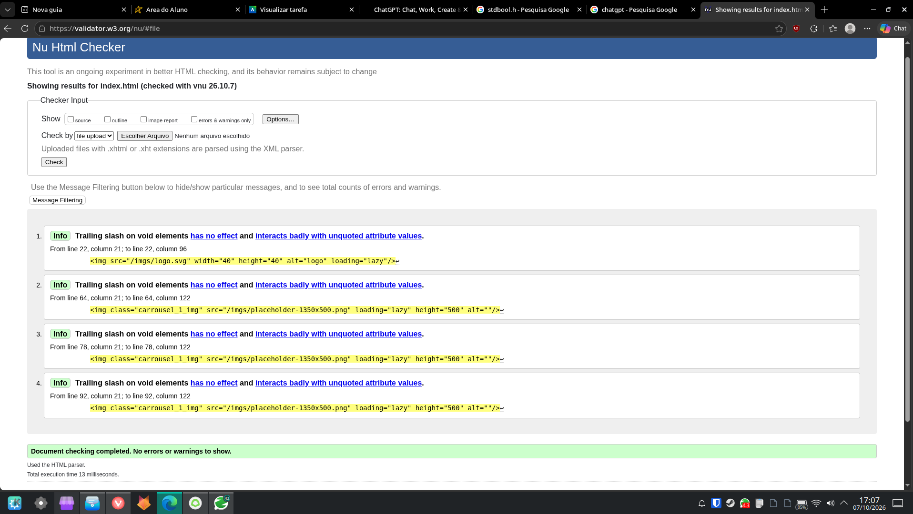
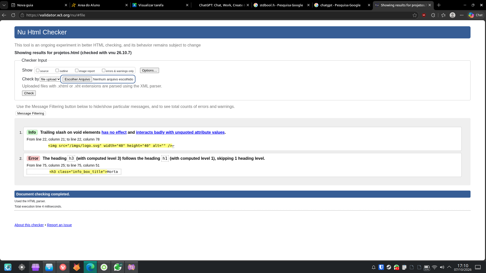
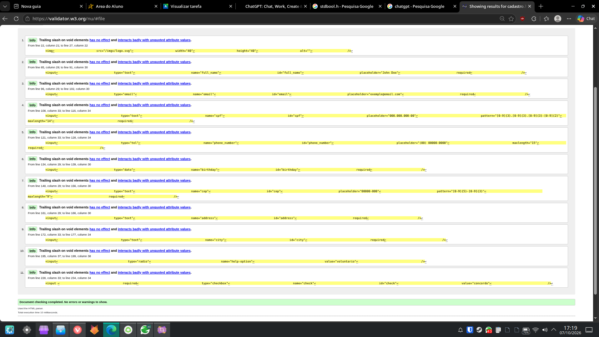

# 🌱 Projeto ONG Ambiental

Projeto de desenvolvimento front-end de um site institucional para uma organização não governamental (ONG) voltada à preservação do meio ambiente e à conscientização ambiental.

O projeto faz parte de uma atividade acadêmica do curso de **Análise e Desenvolvimento de Sistemas (ADS)**, com o objetivo de aplicar conhecimentos de desenvolvimento web na criação de uma interface moderna, acessível e responsiva.

## 🎯 Objetivos

* Desenvolver um site institucional para uma ONG ambiental.
* Promover a conscientização sobre a preservação do meio ambiente.
* Apresentar iniciativas, projetos e ações ambientais.
* Aplicar conceitos de HTML, CSS e JavaScript no desenvolvimento de interfaces.
* Praticar princípios de responsividade, usabilidade e organização de código.

## ✨ Funcionalidades

* **Página inicial:** apresentação da organização e de sua missão.
* **Página de projetos:** apresentação e organização de projetos.
* **Página de cadastro:** formulario de cadastro para registro de novos apoiadores.
* **Carrossel de destaques:** exibição de mensagens e iniciativas ambientais.
* **Seção institucional:** informações sobre a ONG e seus objetivos.
* **Projetos ambientais:** apresentação de ações voltadas à sustentabilidade.
* **Design responsivo:** adaptação da interface a diferentes tamanhos de tela.

> As funcionalidades descritas podem ser ajustadas conforme a implementação final do projeto.

## 🛠️ Tecnologias utilizadas

* HTML5
* CSS3
* JavaScript

## 📁 Estrutura do projeto

```text
ong-ambiental/
├── index.html
├── cadastro.html
├── projetos.html
├── css/
├── js/
├── imgs/
└── README.md
```

## 🚀 Como executar

1. Clone este repositório:

   ```bash
   git clone URL_DO_REPOSITORIO
   ```

2. Entre na pasta do projeto:

   ```bash
   cd ong-ambiental
   ```

3. Abra o arquivo `index.html` no navegador ou utilize uma extensão como Live Server no Visual Studio Code.

## ♻️ Importância do projeto

A tecnologia pode ser uma ferramenta importante para ampliar o alcance de iniciativas socioambientais. Por meio de um site institucional, uma organização pode divulgar suas ações, compartilhar informações relevantes e incentivar a participação da comunidade na preservação ambiental.

## 🎓 Contexto acadêmico

Projeto desenvolvido para fins educacionais na disciplina de **Front-End**, do curso de Análise e Desenvolvimento de Sistemas (ADS).

## 📄 Licença

Este projeto foi desenvolvido para fins acadêmicos. Os termos de utilização e distribuição poderão ser definidos conforme a necessidade do projeto.

---

Desenvolvido como parte das atividades acadêmicas do curso de ADS. 🌿

## W3C Validator

index.html



projetos.html



cadastro.html




